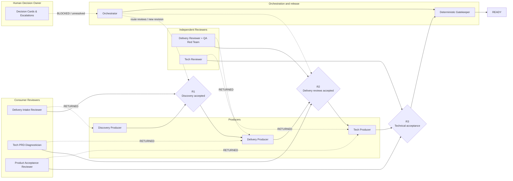

# AI-Native Agile Product-Engineering: A Multi-Agent Collaborative Architecture from PRD to Tech Design

**AI-Native Agile Product-Engineering** is a portable multi-agent product-engineering architecture. It coordinates Producers, downstream Consumer Reviewers, Independent Reviewers, Human Decision Owners and a deterministic Gatekeeper to carry an idea from requirement discovery through PRD, delivery artifacts and technical design with traceable, evidence-backed handoffs.

中文项目名：**AI 原生敏捷产研：从 PRD 到技术方案的多智能体协同架构**

The project separates a **portable methodology core** from **environment-specific adapters**:

- The core defines producer/reviewer roles, handoff contracts, authority boundaries, the discovery and delivery processes, gates, finding ledger, rerun rules and orchestration state.
- Adapters provide optional integrations with issue trackers, code-search systems, knowledge bases, Git repositories, UI kits, and model hosts.
- A run can execute with no network or external service by using the bundled manual/neutral adapters.

## What it does

A complete product-engineering run produces six primary artifacts in a fixed order:

1. `Issue_Description.md` — concise, human-readable issue summary
2. `Overview.html` — offline review page
3. `PRD_DELIVERY.md` — the sole source of business truth
4. `Prototype.html` — optional interaction prototype
5. `Gates.md` — gate results, findings, owners, and next actions
6. `Workflow.md` — execution summary, hashes, decisions, and status

After the six candidates are sealed, an independent worker runs the full review `R0/G1/O1/U1/U2/QA/Q1`. The final delivery also includes a separate `gate-outputs/` directory with `Final_Gate_Review.md` and one Gate Result v2 JSON for each gate. The wider three-stage workflow adds cross-stage consumer reviews and a final deterministic Gatekeeper.

Discovery can optionally run first and produce:

```text
Requirement_Brief.md
.context/context-snapshot.json
.context/capability-ideation.json
.context/capability-matrix.json
```

Discovery and Delivery are independent. Discovery is not a mandatory predecessor of Delivery.

## How agents collaborate


- **Producers create frozen handoffs.** Discovery, Delivery and Tech Solution each own their stage output.
- **Downstream consumers accept or reject.** Delivery checks whether Discovery is sufficient; Tech Solution diagnoses whether the PRD is implementable; Delivery verifies whether the technical solution faithfully inherits the product contract.
- **Independent reviewers challenge the work.** Delivery Reviewer + QA Red Team and Tech Reviewer use separate contexts and evidence-backed checks.
- **Humans decide business choices.** Decision Cards cover permissions, scope, irreversible risk and unresolved disagreement.
- **A deterministic Gatekeeper decides readiness.** It verifies the review chain, hashes, evidence, blockers, decisions and escalations; no agent can override it.

[Open the Chinese 16:9 presentation version](docs/assets/agent-collaboration-swimlane-zh.png) · [Open the English SVG](docs/assets/agent-collaboration-swimlane.svg)

<details>
<summary>Editable Mermaid overview</summary>



</details>

The native SVG files are standalone and can be inserted into slide decks. Regenerate them with:

```bash
python tools/build_agent_swimlane.py
node tools/render_agent_swimlane.mjs
```

## Core ideas

- **Separation of duties.** Producers cannot approve their own work; downstream consumers and independent reviewers use distinct contexts.
- **Bidirectional acceptance.** Delivery validates Discovery sufficiency; Tech Solution diagnoses PRD completeness; Delivery performs product acceptance of the technical solution.
- **PRD is the sole fact source.** Overview, prototype, issue description, tests, and generated summaries consume the PRD; they never redefine it.
- **Discovery is evidence based.** Claims about existing capability must identify their source and confidence.
- **Gates stay independent.** Prototype, overview, or QA failures do not silently rewrite the PRD gate.
- **Evidence-first PASS.** A passing gate needs an executed check ledger, evidence references, input hashes, an independent review worker, and zero blockers; an empty findings array is never proof.
- **Findings are root-cause based.** The same problem keeps one stable identity across artifacts and reruns.
- **Formal gates are full-copy based.** Every candidate revision is sealed and every formal review reruns all gates on that frozen copy; hashes prove the reviewed copy did not change.
- **Cross-artifact preflight.** Role/permission matrices, action contracts, enum dictionaries, exception fields, and timeout events are checked before formal G1/U1 scoring.
- **External systems are adapters.** No company endpoint, tracker field, Git host, UI library, or private knowledge base is hard-coded in the core.
- **Deterministic final gate.** The Gatekeeper is a program that checks the complete review chain, evidence, hashes, decisions and escalations.
- **Read only by default.** The framework does not update external systems unless a write adapter is explicitly enabled and separately confirmed.

## Repository map

```text
.
├── core/                 Portable methodology, authority and collaboration contracts
├── agents/               Role index and producer/reviewer definitions
│   └── roles/
├── skills/               Agent-facing orchestration, Discovery, Delivery and Tech Solution skills
├── engine/               Workflow stage contracts
├── adapters/             External-system interface specifications
├── templates/            Neutral artifact templates
├── schemas/              JSON contracts for handoffs, reviews, decisions and workflow state
├── examples/             Synthetic, non-company demo input/output
├── tools/                Local validation and sanitization utilities
└── docs/                 Architecture and operation guides
```

## Quick start

1. Inspect `config/config.example.yaml`.
2. Read `skills/ai-native-orchestrator/SKILL.md`.
3. Read the role boundaries in `agents/roles/` and `core/authority-matrix.md`.
4. Run the end-to-end orchestration example:

```bash
python tools/orchestrate.py init --run-root /tmp/demo-run --workflow-id demo-1 --requirement-name Demo
```

5. Use only the bundled adapters for a no-network run.
6. Replace adapters only when your environment permits their use.

## Default adapter set

| Capability | Default | Result |
|---|---|---|
| Issue tracker | `manual` | Requirement text is supplied by the user |
| Code intelligence | `none` | Code-backed claims remain unverified |
| Knowledge source | `none` | No historical-reference claims are generated |
| Git source | `none` | Branch-level implementation is not asserted |
| UI kit | `neutral-html` | Produces a standalone HTML prototype |
| Model provider | `host-agent` | Uses the hosting agent/runtime |
| Agent runtime | `agent-runtime` | Spawns isolated producer/reviewer contexts or maps them to another runtime |

## PRD_ONLY minimum execution loop

`agent_task_factory.py` converts a dependency-ready Delivery Work Plan task into a frozen, schema-valid Agent Task. It includes the requirement input and every successful dependency result, each bound by SHA-256.

```bash
python tools/agent_task_factory.py   --run-root /tmp/demo-run   --plan .agents/delivery-plan.json   --task-id PRD-PRODUCE   --requirement requirement.md   --runtime codex

python tools/delivery_loop.py   --run-root /tmp/demo-run   --plan .agents/delivery-plan.json   --requirement requirement.md   --worker tools/deterministic_worker.py
```

The minimum loop currently proves PRD_ONLY DAG ordering, dependency-bound context construction, structured execution, Work Plan/Runtime state synchronization and fail-safe stopping. Producer tasks materialize a frozen `PRD_DELIVERY.md` artifact; the task factory forwards its path and SHA-256 to downstream reviewers. Reviewer workers emit contract-valid Review Results into `.agents/reviews`; after the three PRD reviews, the loop reconciles findings, completes `FINDING-CONSOLIDATE`, creates and executes dependency-ready `PRD-REPAIR-*` tasks. A clean run reaches `M1_CONTRACT_COMPLETE` through Final Package Review, Deterministic Gatekeeper and Delivery Handoff. A blocking finding additionally creates `PRD-REPAIR-*`, runs three Reviewer Recheck tasks, then reaches the same completed state. Recheck, gatekeeper and handoff results are contract validated. `deterministic_worker.py` is a contract worker; real Producer and Reviewer adapters replace it without changing the loop contract.

## Codex semantic worker adapter

`codex_worker.py` is the controlled bridge from Agent Tasks to semantic Codex execution. It builds a role-specific prompt, injects every frozen input path and output path, invokes `codex exec --ephemeral --skip-git-repo-check --sandbox read-only --output-last-message ...`, captures stdout/stderr to the task transcript, and accepts only the required structured JSON envelope.

```bash
python tools/delivery_loop.py   --run-root /tmp/demo-run   --plan .agents/delivery-plan.json   --requirement requirement.md   --worker tools/codex_worker.py   --timeout 120
```

The default sandbox is read-only. A Producer that must write its bounded artifact directory can use `--sandbox workspace-write` through the adapter CLI or a task-specific command. Invalid or non-JSON Codex output fails closed. `fake_codex.py` is used only by regression tests.

## Real runtime, Producer Registry and Research synthesis

M6 adds three production-readiness capabilities:

```bash
# Real Chromium evidence via Playwright
python tools/delivery_pipeline.py ...   --browser-runner python3 adapters/browser-runtime/playwright_runner.py   --require-real-browser

# Registered semantic/provided producers for Prototype, Overview and Jira
python tools/delivery_pipeline.py ...   --producer-registry examples/research/producer-registry.example.json

# Research query -> Research Record / TECH gap / Product Decision Card
python tools/synthesize_research.py   --request research-request.json   --query-result research-query-result.json   --run-root <runRoot>

# Explicit product decision closure and PRD resync instruction
python tools/close_decision.py   --decision <decision-card.json>   --selected-option A   --closed-by product-owner   --out <confirmed.json>   --resync-out decision-resync.json
```

Static runtime remains `STATIC_CONTRACT`; only real browser evidence can support a production candidate Prototype. See `docs/m6-production-runtime-and-producers.md`.

## Production quality and Research adapters

Research queries execute through read-only adapters with timeout, retry and attempt-level evidence:

```bash
python tools/run_research_queries.py   --request examples/research/research-request.example.json   --adapters examples/research/adapter-config.example.json   --out /tmp/research-query-result.json
```

The bundled Jira adapter uses Project Management Space snapshots:

```text
adapters/research/providers/project_management_space_adapter.py
```

Delivery artifacts now have an explicit production-quality contract:

```bash
python tools/validate_delivery_artifacts.py   --prd PRD_DELIVERY.md   --artifact-profile PRD_PLUS_PROTOTYPE   --producer-mode provided   --prd-producer-mode semantic   --prototype Prototype.html   --manifest prototype-manifest.json   --overview Overview.html   --jira Jira_Description.md   --out artifact-quality.json
```

`deterministic` artifacts are structurally valid but remain `BASELINE_ONLY`. Production candidates require semantic/provided downstream artifacts and a semantic/provided PRD producer, recorded from Runtime Results rather than asserted by a flag.

The pipeline accepts high-quality external artifacts with `--artifact-source-dir` and still runs Pair, runtime, consistency, semantic coverage, Quality Exit and Handoff gates. See `docs/m5-production-quality-and-adapters.md`.

## Unified Delivery pipeline

`delivery_pipeline.py` now executes the full artifact chain rather than stopping at a PRD-only contract:

```bash
python tools/delivery_pipeline.py   --run-root /tmp/delivery-run   --requirement requirement.md   --workflow-id demo-1   --requirement-name Demo   --artifact-profile PRD_PLUS_PROTOTYPE   --prototype-status TRIGGERED   --ui-ownership LOCAL
```

The pipeline builds PRD, Prototype, Pair, final semantic evidence, Overview, Jira Description, Quality Exit and Delivery Handoff, then evaluates the baseline COMPLETE gate. Formal finalization defaults to `--readiness-mode gate`: `PACKAGE_READY` requires `CONTENT_READY`, `EVIDENCE_READY` and `BUNDLE_READY`; otherwise it returns `PACKAGE_BLOCKED`. `--readiness-mode advisory` is for structural smoke runs only. Production COMPLETE still requires real 3-5 sample benchmark and replay evidence.

Research packages can be imported and hash-verified before the run:

```bash
python tools/delivery_pipeline.py ... --research-package /path/to/package
```

See `docs/m4-unified-delivery.md`.

## Gate policy packs and rule coverage

Gate rules are compiled into a frozen machine-readable policy pack. Formal Gate Results must bind the same `policyLockSha256` and return one result for every applicable `ruleId`.

```bash
python tools/build_policy_lock.py   --artifact-profile PRD_PLUS_PROTOTYPE   --requirement-types CRUD,UI_INTERACTION   --prototype-status TRIGGERED   --ui-ownership LOCAL   --out .delivery/policy-lock.json

python tools/validate_gate_rule_coverage.py   --policy-lock .delivery/policy-lock.json   --gate-dir .delivery/gate-results/<revision>   --out .agents/gate-rule-coverage.json
```

Missing, unknown, duplicate or non-passed applicable rules block PASS. See `docs/gate-policy-coverage.md`.
The policy lock is converted into producer-facing Generation Obligations. Producer and Reviewer Agent Tasks freeze both files:

```bash
python tools/build_generation_obligations.py   --policy-lock .delivery/policy-lock.json   --workflow-id <workflowId>   --out .agents/policy/generation-obligations.json
```

See `docs/generation-obligations.md`.
Producers must return `obligationDeclarations` for every declaration-required obligation. The Pipeline collects them into `.delivery/obligation-declarations.json` and includes coverage in Delivery Readiness. A declaration is not a Gate PASS.

## Delivery readiness integrity

`DESIGN_READY` is now split into three independent checks:

```text
CONTENT_READY   semantic package and stable Prototype bindings
EVIDENCE_READY  internally consistent gates, hashes and final seal
BUNDLE_READY    self-contained, replayable delivery root
```

```bash
python tools/validate_prototype_binding.py   --prototype Prototype.html   --manifest prototype-manifest.json   --prd PRD_DELIVERY.md   --json

python tools/verify_delivery_bundle_integrity.py   --bundle 01-delivery   --out .agents/delivery-readiness.json
```

A contradictory hash-stability check invalidates a gate even if the gate result says PASS. A final package that depends on files outside its delivery root is not bundle-ready. See `docs/delivery-readiness.md`.

## Semantic decomposition and integration review

Long Delivery bundles can now be decomposed into Global Contracts, Feature Slices, Acceptance Criteria, Interaction Contracts and Journeys, then reviewed at four layers:

```text
CONTRACT -> LOCAL -> EDGE -> GLOBAL
```

The pipeline records:

```text
.agents/context/generation-contract.json
.agents/semantics/delivery-semantic-model.json
.agents/semantics/semantic-integration-review.json
.agents/semantics/review-jobs/job-manifest.json
```

Default mode is `advisory`; strict enforcement is opt-in:

```bash
python tools/delivery_pipeline.py ...   --generation-contract-mode gate   --semantic-decomposition-mode gate
```

See `docs/semantic-decomposition.md` for the model, job contract, worker runner and consolidation rules.

## Semantic review, quality benchmark and Delivery COMPLETE gate

Three deterministic quality surfaces sit after the producer/reviewer loop:

```bash
# Six-axis semantic consistency review over a frozen evidence ledger
python tools/semantic_consistency_review.py   --input examples/semantic-review/accepted.json   --out /tmp/semantic-review.json

# P0.5 quality measurement over 3..5 runs
python tools/evaluate_delivery_quality.py   --input examples/p05/delivery-quality-baseline.json   --out /tmp/quality-benchmark.json

# Aggregate M1, M2, P0.7, M3, P0.5, Handoff and replay evidence
python tools/delivery_complete_gate.py   --input examples/delivery-complete/gate-input.json   --out /tmp/delivery-complete.json
```

The bundled benchmark is synthetic and cannot reach `productionEligible=true`. The COMPLETE gate accepts it only as `BASELINE_READY`; `PRODUCTION` requires 3..5 real production-eligible samples and replays both the semantic review and benchmark from their frozen inputs.

Research records distinguish `PRODUCT`, `TECH` and `DELIVERY` resolution owners. Missing interface contracts or unavailable MCP evidence are routed to Tech research instead of becoming unnecessary product questions.

## Safety boundary


This project is designed to be safe to run in a closed environment:

- No credentials are committed.
- No write adapter is enabled by default.
- No historical company/customer data is required.
- Synthetic examples are fictional.
- Before publishing or contributing, run `tools/sanitize_scan.py`.

## License

The repository is prepared under the MIT License. Adjust the copyright line before your first public release if you choose a different license.

## Artifact profiles and prototype contracts

The core routes requirements by artifact profile instead of forcing every request through a local UI workflow:

- `PRD_ONLY`: no local Prototype; UI gates are `NOT_APPLICABLE`, while product, data, event, permission and recovery contracts remain required.
- `PRD_PLUS_PROTOTYPE`: Prototype Contract Preflight, visible interaction checks and clean runtime evidence are required.
- `EXISTING_PROTOTYPE_REVIEW`: review a supplied Prototype before treating it as an input.
- `EXTERNAL_UI_BOUNDARY`: the external owner supplies the UI; the run records a UI Boundary Contract instead of inventing a Prototype.

Artifact Profile and Prototype Contract are portable core contracts. They do not depend on Jira or any external gate.

```bash
python tools/orchestrate.py init \
  --run-root /tmp/demo-run \
  --workflow-id demo-1 \
  --requirement-name Demo \
  --artifact-profile PRD_PLUS_PROTOTYPE \
  --prototype-status TRIGGERED \
  --ui-ownership LOCAL

python tools/orchestrate.py validate-profile \
  --profile artifact-profile.json \
  --prototype-contract prototype-contract.json
```

A Runtime PASS requires zero unhandled console errors. A visible interaction is not complete unless its visible label, clickability, target view and preserved context are evidenced.

## Artifact Pair and PRD-Prototype consistency gate

For `PRD_PLUS_PROTOTYPE` and `EXISTING_PROTOTYPE_REVIEW`, PRD, Prototype, Overview and Prototype Manifest are sealed as one revision-bound Artifact Pair.

```bash
python tools/build_artifact_pair.py   --workflow-id WF-1   --artifact-profile PRD_PLUS_PROTOTYPE   --prd PRD_DELIVERY.md   --prototype Prototype.html   --prd-revision r3   --prototype-revision r3   --overview Overview.html   --overview-revision r3   --out artifact-pair.json

python tools/validate_artifact_consistency.py   --pair artifact-pair.json   --prd PRD_DELIVERY.md   --prototype Prototype.html   --manifest prototype-manifest.json   --previous-manifest prototype-manifest-r2.json   --overview Overview.html   --out consistency-result.json
```

The deterministic gate checks revision and hash binding, PRD FR/AC ↔ UI element links, HTML `data-ai-id` drift, missing and orphan UI elements, stale Overview, and deleted-element reconciliation. If Prototype deletes `UI-approval-comment` while PRD still contains `FR-008` / `AC-014`, the gate emits `DELETED_UI_ELEMENT_STILL_PRESENT_IN_PRD` with the exact UI element, FR, AC, owner and close condition. A non-`SYNCED` pair cannot reach the final Gatekeeper.

### Prototype Delta and PRD reconciliation

```bash
python tools/build_prototype_delta.py   --previous prototype-manifest-r2.json   --current prototype-manifest-r3.json   --workflow-id WF-1   --out prototype-delta.json

python tools/reconcile_prototype_delta.py   --delta prototype-delta.json   --prd PRD_DELIVERY.md   --from-prd-revision r2   --to-prd-revision r3   --status SYNCED   --apply   --out prd-reconciliation.json
```

`artifact_sync_loop.py` coordinates Delta → Reconciliation → Artifact Pair reseal → Consistency Gate → Repair Group → Final Gate. `plan_artifact_repairs.py` converts blocking consistency findings into owner-specific PRD / Prototype / Overview repair tasks.

### Small multi-requirement lane runner

```bash
python tools/lane_runner.py --manifest lanes.json --workspace /tmp/requirement-lanes --max-workers 5 --out lane-summary.json
```

The runner supports up to five isolated `PRD_ONLY` requirement lanes. Each lane has an independent runRoot, Workflow ID, Runtime Records and artifacts. A failed lane does not block successful lanes. `totalDurationSeconds`, `queueWaitSeconds` and `gateDurationSeconds` are recorded per lane.

## Evidence-only change classification

When only Gates, Workflow, transcripts, seals or runtime evidence change, the quality core must not restart the Producer/Reviewer chain. Use the deterministic classifier:

```bash
python tools/classify_change.py \
  --previous <previous-revision> \
  --current <current-revision> \
  --previous-revision r1 \
  --current-revision r2 \
  --out change-classification.json
```

Semantic changes require full core review. Projection changes require projection review. Evidence-only changes require deterministic evidence recheck. Unknown changes fail safe to manual triage.

Runtime PASS rejects console diagnostics, page errors and request failures; a key assertion passing does not override an unhandled runtime error.

## Structured Context Packs

Context is shared as frozen facts and evidence, not private reasoning. Build a `PROJECT`, `REQUIREMENT` or `ROLE` pack from structured inputs; every fact carries a source reference and hash. Packs are deterministic and do not depend on Jira or any external gate.

```bash
python tools/orchestrate.py build-context-pack \
  --pack-type ROLE \
  --requirement-id DEMO-1 \
  --revision r1 \
  --role qa-red-team \
  --scope FR-1 \
  --input project-context.json \
  --input requirement-context.json \
  --out role-context-pack.json
```

A Producer/Reviewer must not share private reasoning. A Context Pack may share frozen facts, source hashes, rule IDs and evidence anchors only.

## ReviewGroup and concurrent state

Reviewers may run concurrently only inside an explicit `ReviewGroup`. State mutations use an orchestration lock and atomic replacement. Group status is aggregated from target handoff, revision and required reviewer verdicts:

```bash
python tools/orchestrate.py review-group-init \
  --run-root /tmp/demo-run \
  --group-id delivery-r1 \
  --stage DELIVERY_REVIEW \
  --target-handoff-id HO-DELIVERY-R1 \
  --target-revision r1 \
  --reviewer delivery-reviewer \
  --reviewer qa-red-team

python tools/orchestrate.py review-group-status --run-root /tmp/demo-run
```

## Runtime Executor MVP

Delivery Work Plan tasks can be packaged into Agent Tasks with frozen input hashes, role boundaries, structured result requirements and an explicit runtime adapter. `noop` validates and records the contract; `process` executes a local argv command; `codex` uses the same argv boundary for `codex exec`.

```bash
python tools/orchestrate.py agent-spawn --run-root /tmp/demo-run --task .agents/tasks/TASK-1.json --delivery-plan .agents/delivery-plan.json
python tools/orchestrate.py agent-spawn --run-root /tmp/demo-run --task .agents/tasks/TASK-1.json --execute
python tools/orchestrate.py agent-collect --run-root /tmp/demo-run --task-id TASK-1 --result .agents/results/TASK-1.json --delivery-plan .agents/delivery-plan.json
python tools/orchestrate.py agent-collect --run-root /tmp/demo-run --task-id TASK-1 --cancel --delivery-plan .agents/delivery-plan.json
```

The runtime validates task schema and frozen input hashes, executes the selected adapter, validates the structured result, records transcript/stderr summaries, hashes the task and result, and fails closed on timeout, non-zero exit, missing results, invalid results and reviewer isolation violations. Runtime records are auditable replay artifacts. Orchestrated spawn/collect can synchronously update the matching Delivery Work Plan task and retain `runtimeRecordPath`.

A real `codex` task is expected to use an argv form equivalent to `codex exec --json --sandbox read-only --output-last-message <result-path> "<review prompt>"` and then persist the adapter's required structured JSON envelope. The portable core itself remains model-neutral.
