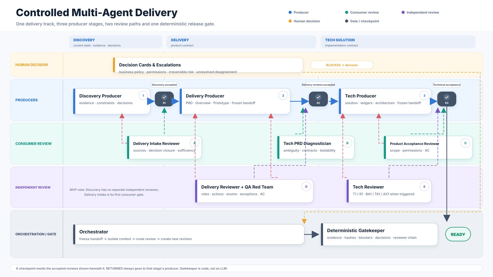
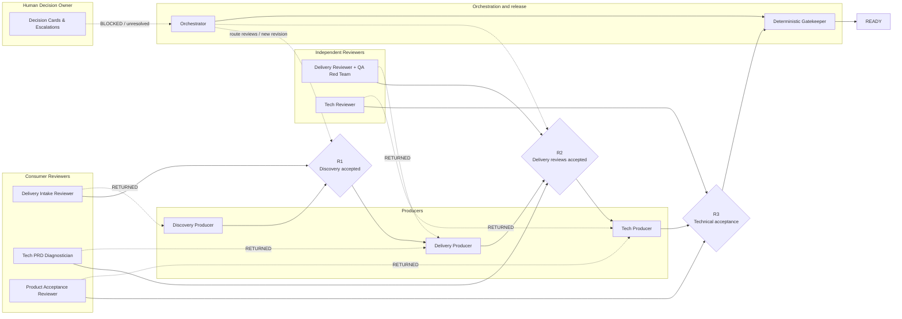

# AI Native Delivery

AI Native Delivery is a portable multi-agent product-requirement workflow framework. It helps product teams move from an idea to a reviewed, traceable delivery bundle through producers, consumer reviewers, independent reviewers and a deterministic Gatekeeper.

The project separates a **portable methodology core** from **environment-specific adapters**:

- The core defines producer/reviewer roles, handoff contracts, authority boundaries, the discovery and delivery processes, gates, finding ledger, rerun rules and orchestration state.
- Adapters provide optional integrations with issue trackers, code-search systems, knowledge bases, Git repositories, UI kits, and model hosts.
- A run can execute with no network or external service by using the bundled manual/neutral adapters.

## What it does

A complete delivery produces six primary artifacts in a fixed order:

1. `Issue_Description.md` — concise, human-readable issue summary
2. `Overview.html` — offline review page
3. `PRD_DELIVERY.md` — the sole source of business truth
4. `Prototype.html` — optional interaction prototype
5. `Gates.md` — gate results, findings, owners, and next actions
6. `Workflow.md` — execution summary, hashes, decisions, and status

After the six candidates are sealed, an independent worker runs the full review `R0/G1/O1/U1/U2/QA/Q1`. The final delivery also includes a separate `gate-outputs/` directory with `Final_Gate_Review.md` and one Gate Result v2 JSON for each gate. The wider three-stage workflow adds cross-stage consumer reviews and a final deterministic Gatekeeper.

Discovery can optionally run first and produce:

```text
Requirement_Brief.md
.context/context-snapshot.json
.context/capability-ideation.json
.context/capability-matrix.json
```

Discovery and Delivery are independent. Discovery is not a mandatory predecessor of Delivery.

## How agents collaborate



- **Producers create frozen handoffs.** Discovery, Delivery and Tech Solution each own their stage output.
- **Downstream consumers accept or reject.** Delivery checks whether Discovery is sufficient; Tech Solution diagnoses whether the PRD is implementable; Delivery verifies whether the technical solution faithfully inherits the product contract.
- **Independent reviewers challenge the work.** Delivery Reviewer + QA Red Team and Tech Reviewer use separate contexts and evidence-backed checks.
- **Humans decide business choices.** Decision Cards cover permissions, scope, irreversible risk and unresolved disagreement.
- **A deterministic Gatekeeper decides readiness.** It verifies the review chain, hashes, evidence, blockers, decisions and escalations; no agent can override it.

[Open the Chinese 16:9 presentation version](docs/assets/agent-collaboration-swimlane-zh.png) · [Open the English SVG](docs/assets/agent-collaboration-swimlane.svg)

<details>
<summary>Editable Mermaid overview</summary>



</details>

The native SVG files are standalone and can be inserted into slide decks. Regenerate them with:

```bash
python tools/build_agent_swimlane.py
node tools/render_agent_swimlane.mjs
```

## Core ideas

- **Separation of duties.** Producers cannot approve their own work; downstream consumers and independent reviewers use distinct contexts.
- **Bidirectional acceptance.** Delivery validates Discovery sufficiency; Tech Solution diagnoses PRD completeness; Delivery performs product acceptance of the technical solution.
- **PRD is the sole fact source.** Overview, prototype, issue description, tests, and generated summaries consume the PRD; they never redefine it.
- **Discovery is evidence based.** Claims about existing capability must identify their source and confidence.
- **Gates stay independent.** Prototype, overview, or QA failures do not silently rewrite the PRD gate.
- **Evidence-first PASS.** A passing gate needs an executed check ledger, evidence references, input hashes, an independent review worker, and zero blockers; an empty findings array is never proof.
- **Findings are root-cause based.** The same problem keeps one stable identity across artifacts and reruns.
- **Formal gates are full-copy based.** Every candidate revision is sealed and every formal review reruns all gates on that frozen copy; hashes prove the reviewed copy did not change.
- **Cross-artifact preflight.** Role/permission matrices, action contracts, enum dictionaries, exception fields, and timeout events are checked before formal G1/U1 scoring.
- **External systems are adapters.** No company endpoint, tracker field, Git host, UI library, or private knowledge base is hard-coded in the core.
- **Deterministic final gate.** The Gatekeeper is a program that checks the complete review chain, evidence, hashes, decisions and escalations.
- **Read only by default.** The framework does not update external systems unless a write adapter is explicitly enabled and separately confirmed.

## Repository map

```text
.
├── core/                 Portable methodology, authority and collaboration contracts
├── agents/               Role index and producer/reviewer definitions
│   └── roles/
├── skills/               Agent-facing orchestration, Discovery, Delivery and Tech Solution skills
├── engine/               Workflow stage contracts
├── adapters/             External-system interface specifications
├── templates/            Neutral artifact templates
├── schemas/              JSON contracts for handoffs, reviews, decisions and workflow state
├── examples/             Synthetic, non-company demo input/output
├── tools/                Local validation and sanitization utilities
└── docs/                 Architecture and operation guides
```

## Quick start

1. Inspect `config/config.example.yaml`.
2. Read `skills/ai-native-orchestrator/SKILL.md`.
3. Read the role boundaries in `agents/roles/` and `core/authority-matrix.md`.
4. Run the end-to-end orchestration example:

```bash
python tools/orchestrate.py init --run-root /tmp/demo-run --workflow-id demo-1 --requirement-name Demo
```

5. Use only the bundled adapters for a no-network run.
6. Replace adapters only when your environment permits their use.

## Default adapter set

| Capability | Default | Result |
|---|---|---|
| Issue tracker | `manual` | Requirement text is supplied by the user |
| Code intelligence | `none` | Code-backed claims remain unverified |
| Knowledge source | `none` | No historical-reference claims are generated |
| Git source | `none` | Branch-level implementation is not asserted |
| UI kit | `neutral-html` | Produces a standalone HTML prototype |
| Model provider | `host-agent` | Uses the hosting agent/runtime |
| Agent runtime | `agent-runtime` | Spawns isolated producer/reviewer contexts or maps them to another runtime |

## Safety boundary

This project is designed to be safe to run in a closed environment:

- No credentials are committed.
- No write adapter is enabled by default.
- No historical company/customer data is required.
- Synthetic examples are fictional.
- Before publishing or contributing, run `tools/sanitize_scan.py`.

## License

The repository is prepared under the MIT License. Adjust the copyright line before your first public release if you choose a different license.

## Artifact profiles and prototype contracts

The core routes requirements by artifact profile instead of forcing every request through a local UI workflow:

- `PRD_ONLY`: no local Prototype; UI gates are `NOT_APPLICABLE`, while product, data, event, permission and recovery contracts remain required.
- `PRD_PLUS_PROTOTYPE`: Prototype Contract Preflight, visible interaction checks and clean runtime evidence are required.
- `EXISTING_PROTOTYPE_REVIEW`: review a supplied Prototype before treating it as an input.
- `EXTERNAL_UI_BOUNDARY`: the external owner supplies the UI; the run records a UI Boundary Contract instead of inventing a Prototype.

Artifact Profile and Prototype Contract are portable core contracts. They do not depend on Jira or any external gate.

```bash
python tools/orchestrate.py init \
  --run-root /tmp/demo-run \
  --workflow-id demo-1 \
  --requirement-name Demo \
  --artifact-profile PRD_PLUS_PROTOTYPE \
  --prototype-status TRIGGERED \
  --ui-ownership LOCAL

python tools/orchestrate.py validate-profile \
  --profile artifact-profile.json \
  --prototype-contract prototype-contract.json
```

A Runtime PASS requires zero unhandled console errors. A visible interaction is not complete unless its visible label, clickability, target view and preserved context are evidenced.

## Evidence-only change classification

When only Gates, Workflow, transcripts, seals or runtime evidence change, the quality core must not restart the Producer/Reviewer chain. Use the deterministic classifier:

```bash
python tools/classify_change.py \
  --previous <previous-revision> \
  --current <current-revision> \
  --previous-revision r1 \
  --current-revision r2 \
  --out change-classification.json
```

Semantic changes require full core review. Projection changes require projection review. Evidence-only changes require deterministic evidence recheck. Unknown changes fail safe to manual triage.

Runtime PASS rejects console diagnostics, page errors and request failures; a key assertion passing does not override an unhandled runtime error.

## Structured Context Packs

Context is shared as frozen facts and evidence, not private reasoning. Build a `PROJECT`, `REQUIREMENT` or `ROLE` pack from structured inputs; every fact carries a source reference and hash. Packs are deterministic and do not depend on Jira or any external gate.

```bash
python tools/orchestrate.py build-context-pack \
  --pack-type ROLE \
  --requirement-id DEMO-1 \
  --revision r1 \
  --role qa-red-team \
  --scope FR-1 \
  --input project-context.json \
  --input requirement-context.json \
  --out role-context-pack.json
```

A Producer/Reviewer must not share private reasoning. A Context Pack may share frozen facts, source hashes, rule IDs and evidence anchors only.

## ReviewGroup and concurrent state

Reviewers may run concurrently only inside an explicit `ReviewGroup`. State mutations use an orchestration lock and atomic replacement. Group status is aggregated from target handoff, revision and required reviewer verdicts:

```bash
python tools/orchestrate.py review-group-init \
  --run-root /tmp/demo-run \
  --group-id delivery-r1 \
  --stage DELIVERY_REVIEW \
  --target-handoff-id HO-DELIVERY-R1 \
  --target-revision r1 \
  --reviewer delivery-reviewer \
  --reviewer qa-red-team

python tools/orchestrate.py review-group-status --run-root /tmp/demo-run
```

## Runtime Executor MVP

Delivery Work Plan tasks can be packaged into Agent Tasks with frozen input hashes, role boundaries, structured result requirements and an explicit runtime adapter. `noop` validates and records the contract; `process` executes a local argv command; `codex` uses the same argv boundary for `codex exec`.

```bash
python tools/orchestrate.py agent-spawn --run-root /tmp/demo-run --task .agents/tasks/TASK-1.json --delivery-plan .agents/delivery-plan.json
python tools/orchestrate.py agent-spawn --run-root /tmp/demo-run --task .agents/tasks/TASK-1.json --execute
python tools/orchestrate.py agent-collect --run-root /tmp/demo-run --task-id TASK-1 --result .agents/results/TASK-1.json --delivery-plan .agents/delivery-plan.json
python tools/orchestrate.py agent-collect --run-root /tmp/demo-run --task-id TASK-1 --cancel --delivery-plan .agents/delivery-plan.json
```

The runtime validates task schema and frozen input hashes, executes the selected adapter, validates the structured result, records transcript/stderr summaries, hashes the task and result, and fails closed on timeout, non-zero exit, missing results, invalid results and reviewer isolation violations. Runtime records are auditable replay artifacts. Orchestrated spawn/collect can synchronously update the matching Delivery Work Plan task and retain `runtimeRecordPath`.

A real `codex` task is expected to use an argv form equivalent to `codex exec --json --sandbox read-only --output-last-message <result-path> "<review prompt>"` and then persist the adapter's required structured JSON envelope. The portable core itself remains model-neutral.
