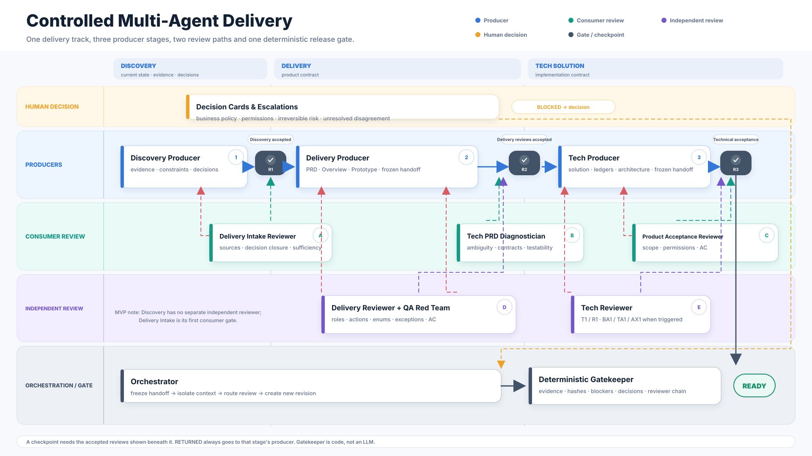

# Agent Orchestration



## 30-second walkthrough

1. Discovery turns current-state evidence and product decisions into a frozen handoff.
2. Delivery Intake reviews whether it is safe to start a PRD; a rejection goes back to Discovery.
3. Delivery produces a product contract; Delivery Reviewer and QA Red Team challenge it independently.
4. Tech PRD Diagnostician decides whether the contract is precise enough for implementation.
5. Tech Producer creates the technical solution; Tech Reviewer and Product Acceptance Reviewer check feasibility and requirement inheritance.
6. The deterministic Gatekeeper verifies the complete evidence chain before `READY`.

> The diagram is about **responsibility and review direction**, not just sequence. A handoff is frozen, a downstream consumer can reject it, and only the original producer may revise it.

Presentation asset: [Chinese 16:9 PNG](assets/agent-collaboration-swimlane-zh.png).

## Why it exists

The workflow has two different control problems:

1. A stage must do its own work well.
2. A downstream stage must decide whether it can safely consume the upstream result.

The second is not satisfied by a linear handoff. It requires a consumer review. Independent quality review is also still required, because upstream and downstream can share the same mistaken assumption.

## Collaboration topology

```text
Discovery Producer
→ Delivery Intake Reviewer
→ Delivery Producer
→ Delivery Reviewer
→ QA Red Team
→ Tech PRD Diagnostician
→ Tech Producer
→ Tech Reviewer
→ Product Acceptance Reviewer
→ Deterministic Gatekeeper
```

`DELIVERY_REVIEW` and `TECH_PRD_DIAGNOSIS` are both performed on the same frozen Delivery handoff but answer different questions:

- Delivery Review: Is the product contract itself complete and internally consistent?
- Tech PRD Diagnosis: Is the product contract sufficiently precise for technical design?
- Product Acceptance: Does the technical solution faithfully implement that contract?

## Artifacts

```text
runRoot/.agents/
├── orchestration.json
├── handoffs/
│   └── <handoffId>.json
├── reviews/
│   ├── <reviewRunId>-plan.json
│   ├── <reviewRunId>.json
│   └── <reviewRunId>.log
├── decisions/
│   └── <decisionId>.json
└── escalations/
    └── <escalationId>.json
```

## Freezing a handoff

The producer writes a handoff containing artifact paths, SHA-256 hashes, decisions, open findings, unknowns and requested reviews. The Orchestrator rejects missing artifacts and hash mismatches.

```bash
python tools/orchestrate.py register-handoff \
  --run-root /tmp/run \
  --file .agents/handoffs/discovery-r1.json
```

## Reviewing

A reviewer first writes a Review Plan:

- questions;
- evidence targets;
- counterexamples;
- selected checks.

Then it writes a Review Result. Accepted results require a complete check ledger with evidence and zero blockers. The reviewer context ID must differ from the producer context ID.

```bash
python tools/orchestrate.py register-review \
  --run-root /tmp/run \
  --plan .agents/reviews/rr-001-plan.json \
  --review .agents/reviews/rr-001.json
```

## Returning work

A `RETURNED` verdict goes back to the producer. The producer creates a new revision and handoff. The previous PASS cannot be reused.

A `BLOCKED` verdict creates a Decision Card. The workflow stays blocked until the decision is confirmed.

Two unresolved disagreement rounds create an Escalation. The Orchestrator does not choose a winner.

## Gatekeeper

The Gatekeeper runs only at `FINAL_GATEKEEPER`. It checks:

- every required handoff exists;
- every required consumer and independent review accepted the latest revision;
- producer and reviewer contexts differ;
- accepted reviews contain evidence;
- every required Decision Card is closed;
- no escalation remains open;
- no blocking finding remains.

The Gatekeeper is deterministic code. No agent can override it.

```bash
python tools/orchestrate.py gatekeeper --run-root /tmp/run
python tools/orchestrate.py validate --run-root /tmp/run
```

## Regression guarantees

The test suite checks:

- full workflow reaches `READY`;
- Discovery intake review can return work;
- self-review is rejected;
- same-context review is rejected;
- accepted review without evidence is rejected;
- open decisions prevent advancement;
- review target revision mismatch is rejected.

## Artifact profile routing

The workflow routes requirements by an explicit Artifact Profile. `PRD_ONLY` and `EXTERNAL_UI_BOUNDARY` do not invent a local Prototype; `PRD_PLUS_PROTOTYPE` and `EXISTING_PROTOTYPE_REVIEW` require Prototype Contract Preflight before the full Delivery Review Group.

A visible interaction is not complete merely because a click handler exists. The contract must evidence a visible label, clickability, target view, preserved context and a clean runtime.
